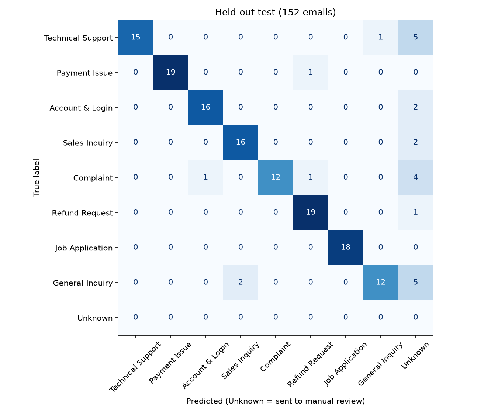
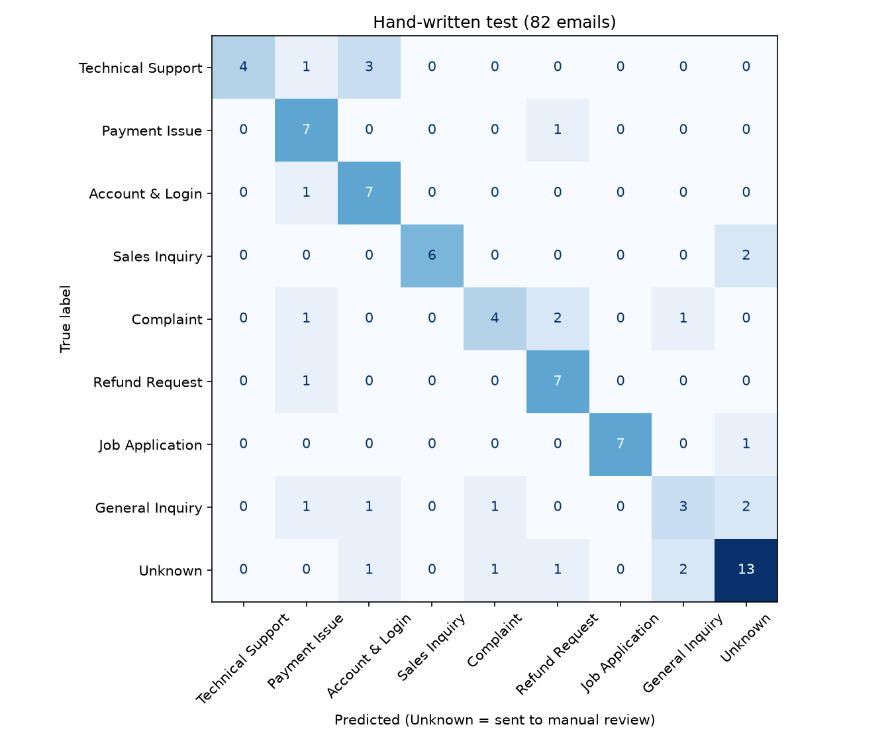

# Email Classification & Routing: a proof of concept
---

## Contents

1. [Summary](#summary)
2. [Introduction and problem](#1-introduction-and-problem)
3. [Dataset](#2-dataset)
4. [Preprocessing](#3-preprocessing)
5. [Models and comparison](#4-models-and-comparison)
6. [Confidence, calibration and the Unknown fallback](#5-confidence-calibration-and-the-unknown-fallback)
7. [Priority](#6-priority)
8. [Explainability](#7-explainability)
9. [Evaluation](#8-evaluation)
10. [Dashboard](#9-dashboard)
11. [Limitations](#10-limitations)
12. [Future work](#11-future-work)
13. [Repository layout and how to run it](#12-repository-layout-and-how-to-run-it)
14. [Additions after the evaluation freeze: junk filter, spam gate, session limit](#13-additions-after-the-evaluation-freeze-junk-filter-spam-gate-session-limit)

---

## Summary

I built a system that reads an email (subject and body) and returns a category, a priority, a department, a confidence score, a short explanation, and, when it isn't sure, a hand-off to a human. The classifier is an average of two logistic regression models, one on TF-IDF features and one on MiniLM sentence embeddings. Confidence is calibrated and drives what happens next: auto-route, route with a review flag, or manual review.

The numbers I'd ask you to look at first are not the validation scores. They are these:

| Test | What it measures | Result |
|---|---|---|
| Held-out test (152 emails, same generator as training) | Accuracy of emails the system routed | **127 / 133 = 95.5%** (19 emails, 12.5%, went to manual review) |
| Held-out test | Auto-routed only (confidence ≥ 85%) | 121 emails, **98.3%** correct |
| Hand-written test (82 emails I wrote to be messy, short, novel or borderline) | Category accuracy, in-category emails | **45 / 64 = 70.3% strict**, 54 / 64 = 84.4% lenient |
| Hand-written test | Accuracy of emails the system routed | **45 / 63 = 71.4%** |
| Hand-written test | Auto-routed only | 43 / 54 = **79.6%** |
| Hand-written test | Unknown emails correctly held back | 13 / 18 (confidence and similarity rules only; the notice filter was added later) |

Two sentences sum it up. On data that looks like the training data, the system is accurate, and when it is confident it is almost always right. On emails that don't look like the training data, its confidence is too high: about one in five auto-routed emails was wrong. The review flag helped as a warning (flagged emails were mostly wrong), but the auto-route threshold alone cannot be trusted outside the data it was built on.

So this is a good triage assistant with a human in the loop. It is not ready to route real mail on its own.

A note on the version you can download: three things were added after the frozen evaluation, so the numbers above describe the system without them. These are the automated-notice filter (Section 5.3), and a junk filter, a spam gate and a ten-email session limit (Section 13). The notice filter has been checked only on training, validation and development emails. The junk filter and spam gate have their own, separate evaluations in Section 13; none of the three has been re-run through the frozen test sets above. The spam gate does not block any of the 152 held-out emails (one is sent to manual review), but that check is a sanity check, not an accuracy measure.

---

## 1. Introduction and problem

### 1.1 The problem

Anyone who runs a shared inbox knows the pattern. A payment dispute, a job application and a locked-out user all arrive in the same place, and somebody has to read each one and decide who should deal with it. That is slow, it is inconsistent between people, and urgent messages can sit behind routine ones.

This project is a proof of concept for automating the first step. Given an email, the system outputs:

- a category from eight configurable classes: Technical Support, Payment Issue, Account & Login, Sales Inquiry, Complaint, Refund Request, Job Application, General Inquiry;
- a priority: High, Medium or Low, from a hybrid of a machine-learning model and keyword rules;
- a department, looked up from a routing table in a config file;
- a confidence score;
- an explanation (the words that pushed the decision, plus similar emails from the training data);
- an Unknown / manual-review fallback for emails the system shouldn't decide by itself.

### 1.2 Design idea: know when not to decide

A classifier that is right 90% of the time but never says which 10% it got wrong is hard to use. So the system is built around confidence-based routing:

| Confidence | Action |
|---|---|
| ≥ 85% | Auto-route to the department |
| 60–84% | Route, with a review flag |
| < 60% | Send to manual review |

Emails that look unlike anything in the training data are also sent to manual review (Section 5). A separate rule-based filter sets aside automated notices such as newsletters and auto-replies, so they are never routed to a team (Section 5.3). Two further steps run before the category model: a junk filter for unusable input and a spam gate for unwanted mail (Section 13). The question the evaluation tries to answer is therefore two questions: how often is the category right, and when the system acts on its own, how often is it right and does its confidence deserve trust?

### 1.3 Routing

Routing lives in `config/pipeline.yaml`, so it can be changed without retraining:

| Category | Department |
|---|---|
| Technical Support | Technical Support |
| Payment Issue | Finance |
| Refund Request | Finance |
| Account & Login | Customer Support |
| General Inquiry | Customer Support |
| Sales Inquiry | Sales |
| Complaint | Customer Success |
| Job Application | HR |
| Unknown | Manual Review |
| Spam (added later) | Spam / Quarantine |

### 1.4 Scope

This is an individual student project. Most of the training data is synthetic, which the brief allows as long as the limitation is documented. I have tried to do that honestly (Section 10) and to build the evaluation so that it doesn't flatter the system.

---

## 2. Dataset

### 2.1 Overview

Three groups of emails are used, kept strictly separate:

| Set | Rows | Used for |
|---|---|---|
| Merged corpus: train / validation / test | 1,008 (705 / 151 / 152) | Training, model selection, held-out test |
| Hand-written development set | 28 | Tuning the Unknown rule |
| Hand-written test set | 82 | Stress test on messy, short, novel and borderline emails |

The corpus is above the 500-email target, but 95% of it is synthetic. The spam data added later is described separately in Section 13.

### 2.2 Sources

**Kaggle: "Multilingual Customer Support Tickets".** The download has 600 rows, of which 163 are in English. I kept the English rows only. The original queue labels were too noisy to use directly (for example, both technical faults and product questions were filed under "Customer Service"), so I mapped queues to my categories, applied keyword rules to the two messiest queues, and then read the 38 flagged emails myself and fixed the labels by hand. The keyword rules were over-eager: they marked 9 emails as Sales, and by the time I had read and corrected them all, only 1 of the 9 was still Sales. Placeholders such as `<n>` and `<acc_num>` were replaced with names and numbers.

The mapping left 157 usable rows. The other 6 came from two queues (Human Resources: 4, Sales and Pre-Sales: 2) that I did not map.

The Kaggle data is also narrow. About 80% of it is Technical Support, and it covers a small set of products (Dell, Canon, Zoom, Jira). That is why the final corpus has only 48 Kaggle rows.

**Synthetic emails.** I had Claude (an LLM) write 960 emails in 24 CSV files: 8 categories × 3 batches × 40 rows. Batches 1 and 2 are cleaner; batch 3 was written deliberately messy (typos, fragments, informal tone, missing greetings). I varied the settings within categories (for example, payment emails cover school fees, hospital billing, rentals, marketplaces and donations) so the model wouldn't just memorise one scenario. Every file was checked for row count, column names, priority mix, length, repeated openings and duplicates before it was merged.

**Hand-written emails.** I wrote 110 emails myself for evaluation only (Section 2.5). Some of the Unknown emails come from my own inbox.

### 2.3 Merging and balancing

The first merge had 249 Technical Support emails against about 120–130 for every other category, almost all of the extra coming from Kaggle. I kept all 120 synthetic Technical Support emails and a random 20 Kaggle ones (seed 42), which cut 109 Kaggle rows and left the corpus balanced.

| Category | Kaggle | Synthetic | Total |
|---|---|---|---|
| Account & Login | 0 | 120 | 120 |
| Complaint | 0 | 120 | 120 |
| General Inquiry | 8 | 120 | 128 |
| Job Application | 0 | 120 | 120 |
| Payment Issue | 10 | 120 | 130 |
| Refund Request | 9 | 120 | 129 |
| Sales Inquiry | 1 | 120 | 121 |
| Technical Support | 20 | 120 | 140 |
| **Total** | **48** | **960** | **1,008** |

Classes range from 120 to 140 emails, so I did not use class weights or resampling for the category model. Exact-duplicate checks found no duplicates in the corpus, none across categories, and no overlap between train, validation, test or the hand-written sets.

### 2.4 Splits

Stratified by category, seed 42, roughly 70 / 15 / 15:

| Category | Train | Validation | Test |
|---|---|---|---|
| Account & Login | 84 | 18 | 18 |
| Complaint | 84 | 18 | 18 |
| General Inquiry | 89 | 20 | 19 |
| Job Application | 84 | 18 | 18 |
| Payment Issue | 91 | 19 | 20 |
| Refund Request | 90 | 19 | 20 |
| Sales Inquiry | 85 | 18 | 18 |
| Technical Support | 98 | 21 | 21 |
| **Total** | **705** | **151** | **152** |

Priority is distributed similarly across the three splits (High 18–22%, Medium 44–46%, Low 34–38%). Five-fold cross-validation in the model comparison uses train + validation (856 emails). The test split was used once, at the end, with models and thresholds frozen.

### 2.5 The hand-written sets

| Set | In-category | Unknown | Total |
|---|---|---|---|
| Development | 16 | 12 | 28 |
| Test | 64 | 18 | 82 |

- **Development set.** 16 messy or novel in-category emails (2 per category) and 12 Unknown emails. I used it to tune the Unknown rule and to design the notice filter.
- **Test set.** 64 in-category emails, 8 per category, in four types: *short* (24), *messy* (16), *borderline* (16, emails that could reasonably belong to two categories) and *novel* (8, topics the training data doesn't cover). Plus 18 Unknown emails: spam, newsletters, wrong recipient, auto-replies, non-English and unrelated messages.
- Priority labels follow my own rubric. For genuinely ambiguous borderline emails I recorded an alternative label (`alt_label`). It is used only for the *lenient* score.
- I did not relabel anything after seeing the results, even where I now think a label is debatable. For instance, "Password reset issue" is labelled Technical Support and the system called it Account & Login, which is arguably the better answer. It counts as an error in the strict score.

### 2.6 What the data looks like

Emails are short: 53.8 words on average (median 44, range 4–166). There are no Unknown examples in the training data. Unknown is produced by rules (Section 5), so the held-out test has no true Unknown emails, and the hand-written test supplies them.

### 2.7 A leak I found while writing this report

While preparing this report I found a problem in the saved split files. Early on, Kaggle emails contained the phrase "Tech Online Store" (from the company name in the original dataset), which gives away the source and, in this corpus, nearly always the class. I removed the phrase, but only from `emails_final.csv`. The `train.csv`, `val.csv` and `test.csv` files had already been written from the earlier version, and they still carry it:

| File | Rows with "Tech Online Store" | Rows with unfilled placeholders (`<order_num>`, `<serial_num>`, …) |
|---|---|---|
| `emails_final.csv` | 0 | 16 |
| `train.csv` | 9 | 11 |
| `val.csv` | 1 | 1 |
| `test.csv` | 1 | 4 |

All of these are Kaggle rows (11 of the 48). I did not fix and retrain, because the final evaluation is frozen and re-splitting would change every number in this report. The effect is probably small, since only 11 of 1,008 emails are affected and one of them is in the test set, but it is real. It could make Technical Support slightly easier to recognise for Kaggle-style emails, and it means the Kaggle-versus-synthetic comparison in Section 8 should not be over-read. A clean rebuild is the first item in Future work.

### 2.8 Limitations of the data

- **95% synthetic.** LLM-written emails are cleaner and more uniform than a real inbox, so scores on held-out data from the same generator are optimistic.
- **Narrow real data.** The 48 real emails cover a handful of products, and only 7 of them are in the test split. They cannot tell us much about real-world performance.
- **Overlapping categories.** Sales/General, Payment/Refund/Technical and Complaint/Refund overlap, so some labels are debatable.
- **Priority labels** were assigned by an LLM (synthetic data) or by my own rubric (hand-written). They are not ground truth from real triage.
- **English only, text only.** No attachments, signatures or thread context.
- **The leak above.**

---

## 3. Preprocessing

All text cleaning lives in one module, `src/preprocess.py`, and the same functions are used for training and for prediction, so the model never sees differently cleaned text in production than it did in training.

**Step 1: combine subject and body.** A leading "Re:", "Fw:" or "Fwd:" is dropped from the subject, and the subject and body are joined into one text.

**Step 2: light cleaning (both models).** HTML tags are removed and entities decoded; URLs become the token `url`; email addresses become `emailaddr`; a trailing sign-off ("thanks", "regards", "sincerely", "yours faithfully" and similar, plus the few words after it) is stripped; whitespace is collapsed. Case, punctuation and stop words are kept, because the sentence-embedding model works best on natural text. This is the input to MiniLM.

**Step 3: full cleaning (TF-IDF only).** On top of step 2: lowercase; every number becomes the token `num`; anything that isn't a letter is removed; single-character tokens are dropped; and English stop words are removed, except a small keep-list of negations (*no, not, nor, never, none, cannot, nothing, without, against*). That list exists because "payment not received" and "payment received" mean opposite things, and a stock stop-word list would delete the difference.

Two things happen before the split rather than inside the pipeline: the Kaggle placeholders were filled with realistic names and numbers (Section 2.7 lists the ones that were missed), and the "Tech Online Store" phrase was removed from Kaggle rows in `emails_final.csv` only.

One known rough edge: the sign-off remover is a regular expression that deletes "thanks / regards / thank you" and up to six following words at the end of the text. On a very short email that ends with "thank you" plus a few real words, it can cut some of them. I haven't measured how often that happens.

The spam model added later (Section 13) uses the same TF-IDF preprocessing, so it sees `url` and `num` tokens rather than raw links and numbers.

---

## 4. Models and comparison

### 4.1 What I compared

All models use the same train / validation split. TF-IDF uses word unigrams and bigrams with sublinear term frequency.

| Model | Val. accuracy | Val. macro F1 | Val. weighted F1 | 5-fold CV macro F1 | Fit time | Prediction time |
|---|---|---|---|---|---|---|
| TF-IDF + Naive Bayes | 0.907 | 0.908 | 0.907 | 0.900 ± 0.013 | 0.09 s | ~0.06 ms |
| TF-IDF + Logistic Regression | 0.940 | 0.941 | 0.940 | 0.924 ± 0.011 | 0.44 s | ~0.1 ms |
| TF-IDF + calibrated Linear SVM | 0.947 | 0.948 | 0.947 | 0.928 ± 0.011 | 0.39 s | ~0.14 ms |
| MiniLM + Logistic Regression | 0.914 | 0.915 | n/r | 0.913 ± 0.012 | n/r | 16–27 ms (embedding) + 0.01 ms |
| MiniLM + nearest centroid | 0.874 | 0.875 | n/r | n/r | n/a | 16–27 ms (embedding) |
| **Ensemble (TF-IDF LR + MiniLM LR, averaged probabilities)** | n/r | n/r | n/r | **0.943 ± 0.013** | n/r | ~16–27 ms (dominated by MiniLM) |

*n/r = not recorded in my notebook. Validation = 151 emails. CV = 5-fold on train + validation (856 emails), seed 42. Timings are on a CPU, per email.*

### 4.2 Complexity and training notes

- **Naive Bayes** is the simplest and fastest, and the least accurate.
- **Logistic Regression and the SVM** train in under half a second and predict in a fraction of a millisecond. They are linear models, so their weights can be read directly, which is what makes the explanations in Section 7 possible.
- **MiniLM** (`all-MiniLM-L6-v2`) is a small pretrained sentence-embedding model. Nothing is fine-tuned. I compute a 384-dimensional embedding per email and train a logistic regression on top. The embedding step costs 16–27 ms per email, about 100× the TF-IDF models, but it needs no training of its own.
- The nearest-centroid variant uses only cosine similarity to each category's average embedding. It is the weakest model but the most interpretable, and it showed that raw similarity alone gets 87% of emails right.

### 4.3 Why the ensemble

On validation, the single TF-IDF models are slightly ahead of MiniLM. In cross-validation they are within noise of each other (0.913 to 0.928, with a standard deviation of about 0.012), so I would not call any one of them the winner.

The ensemble is a different story. Averaging the TF-IDF and MiniLM probabilities gave a CV macro F1 of 0.943, about two points above any single model. That is not a huge gain, but it is consistent with the two models making partly different mistakes. In the validation errors, some emails are missed by both (the "Error 5003" donation email, for example) and others by only one.

There is also a practical reason. I need MiniLM embeddings anyway, for the "does this look like anything I was trained on?" check (Section 5) and for the nearest-example explanations (Section 7). Once they exist, adding them to the vote costs almost nothing extra.

Two honest caveats. First, if speed were the only goal, the calibrated SVM is the better choice: 0.14 ms against roughly 100× that. Second, the ensemble CV number (0.943) was computed with `C=10` for both models, before I tuned them for calibration (Section 5). The final models use `C=300` (TF-IDF) and `C=100` (MiniLM), so the final system is not exactly the one in that comparison.

---

## 5. Confidence, calibration and the Unknown fallback

### 5.1 The first attempt failed

My first version just averaged the two models' probabilities and applied the thresholds. On validation, 140 of 151 emails went to manual review, even though 139 of the 151 predictions were correct. Averaging two probability vectors flattens them, so the correct predictions had a mean confidence of only 0.44, and almost nothing reached the 60% threshold. A system that sends 93% of mail to a human is useless.

### 5.2 Calibration

I fixed this in two steps, using the training set only:

1. **Choose the regularisation strength `C` by out-of-fold log loss.** For TF-IDF, loss kept falling up to `C = 300`, the largest value in my grid (1, 10, 30, 100, 300): 1.455, 0.780, 0.609, 0.483, 0.405. So the true optimum may be higher, and extending the grid is a small to-do. For MiniLM, `C = 100` was best (0.313).
2. **Fit one temperature** on the out-of-fold ensemble probabilities. The fitted value was T = 0.517. A value below 1 sharpens the probabilities, which is what averaging needed.

On the validation set, after calibration (before the Unknown rule):

| Action | Emails | Correct |
|---|---|---|
| Auto-route (≥ 85%) | 130 | 99.2% |
| Route with flag (60–84%) | 16 | 75.0% |
| Manual review (< 60%) | 5 | 40.0% |

Correct predictions now had a mean confidence of 0.96 against 0.68 for wrong ones, which is the separation you want.

### 5.3 Catching emails that don't belong anywhere

Confidence alone can't spot emails outside the eight categories. A newsletter can still look "confidently" like a General Inquiry. So there are three safeguards, in the order the code applies them. (After the freeze, a junk filter and a spam gate were added in front of these; see Section 13.)

1. **A rule-based notice filter** (`src/notices.py`) runs first. It looks for phrases typical of machine-generated mail, such as "unsubscribe", "no-reply", "booking confirmed" and "amount paid". An email it catches never reaches the model: it gets the category Unknown, the department "Filtered (automated)", the action `filtered` and no priority. It flagged none of the 856 training and validation emails.
2. **Low confidence.** If the top class probability is below 0.60, the email goes to manual review.
3. **Low similarity.** If the maximum cosine similarity between the email's MiniLM embedding and any training email is below 0.42, the email is labelled Unknown with the reason "unlike training emails".

For Unknown results from steps 2 and 3, the closest category is kept as the model's guess, and the dashboard shows the confidence as n/a. `min_margin` (a check on the gap between the top two classes) exists in the config but is switched off: with the other thresholds it could never trigger.

One thing matters for reading Section 8: **the frozen evaluation was run without the notice filter.** I added it to `predict()` afterwards. In the saved test predictions no email has a confidence of 0.0, which is what a filtered email would show, so the Unknown results there come from steps 2 and 3 alone. The filter was designed and checked only on training, validation and development emails, and I have not measured what it does to the test emails. Doing that now would be a post-hoc look at test data, so its honest status is "added, not evaluated".

### 5.4 How the 0.42 was chosen, and how much to trust it

I tuned on two small sets, which is a weakness:

- On the 28-email dev set, a similarity threshold of 0.48 caught 10 of 12 Unknown emails without sending any in-category dev email to review.
- On validation, 0.48 pushed 30 of 151 emails to manual review (against 13 at 0.42), so I lowered it to 0.42. At 0.42 on validation: 125 auto-routed (99.2% correct), 13 flagged (76.9%), 13 manual review (69.2% correct).

The similarity signal is also not clean. On the dev set, in-category emails had a maximum similarity between 0.50 and 0.83, but Unknown emails ranged from 0.26 to 0.54, so there is an overlap. A generic auto-reply (0.54) and an unrelated message (0.54) scored higher than some real emails. That overlap is part of why the hand-written test misses some Unknown emails.

The 13 of 18 Unknown emails caught on the hand-written test come from the confidence and similarity rules alone. Even so, the 0.42 threshold was tuned on dev and validation emails, and the test Unknown emails (newsletters, auto-replies, spam, wrong recipient, non-English and unrelated) are of the same kinds as the dev ones, so I would treat 13 of 18 as probably a best case. The notice filter's own rules were written after reading the dev emails, which is a further reason to test it on fresh emails before trusting it.

---

## 6. Priority

### 6.1 Approach

Priority is a hybrid. A TF-IDF logistic regression (`C=10`, balanced class weights) predicts High / Medium / Low, and a small set of keyword rules can raise an email to High.

### 6.2 Why add rules

The ML model alone predicts priority reasonably on validation (accuracy 0.762, macro F1 0.754) but misses urgent emails: High recall was only 0.64. Predicting from category alone (the most common priority per category) scored 0.603 accuracy and 0.458 macro F1, so the model is learning more than just the category.

I evaluated eight candidate rules on the *training set*, using out-of-fold ML predictions so the rules weren't judged on data the model had memorised. For each rule I counted how often overriding the model to High was right (a "gain") or wrong (a "loss").

| Rule | Fires | Override precision | Kept? |
|---|---|---|---|
| `escalation` (legal action, consumer forum, regulator…) | 15 | 0.71 | Yes |
| `asap` (as soon as possible, immediately, right away…) | 34 | 0.53 | Yes |
| `money_lost` (charged twice, double debit…) | 30 | 0.50 | Yes |
| `security` (hacked, unauthorised access…) | 12 | 0.50 | Yes |
| `urgent` (urgent, emergency) | 45 | 0.46 | Yes |
| `safety` | 11 | 0.40 | No |
| `deadline` (today, tonight, by 5 pm…) | 51 | 0.33 | No |
| `outage` (down, nobody can access…) | 22 | 0.29 | No |

I kept the five rules that improved High recall at an acceptable cost in precision. On the training out-of-fold data, they moved High recall from 0.576 to 0.768 (precision 0.692 → 0.636). The three rejected rules fire often but are wrong more than half the time. A negation guard stops phrases like "not urgent" or "low priority" from firing the urgency rules.

### 6.3 Results

| | Accuracy | Macro F1 | High recall | High precision |
|---|---|---|---|---|
| Category-only baseline (val) | 0.603 | 0.458 | n/r | n/r |
| ML only (val) | 0.762 | 0.754 | 0.64 | 0.78 |
| **Hybrid (val)** | **0.775** | **0.775** | **0.85** | **0.72** |

On validation the rules overrode 12 predictions: 7 became correct and 5 became wrong. A net gain of two emails is small and I wouldn't oversell it, but the High-recall improvement is the point. Missing an urgent email is worse than over-escalating a routine one.

Priority is withheld ("NA") for any email sent to manual review. Running validation through the full pipeline therefore gives 0.715, not 0.775, because NA rows count as wrong.

On the final held-out test, priority was weaker (Section 8.2): the rules over-escalate Medium emails to High (High precision 0.58), and Low emails are often read as Medium. Priority is the weakest part of the system.

---

## 7. Explainability

Every prediction comes with two kinds of evidence:

- **Top terms.** For the TF-IDF model, the words and phrases that pushed hardest toward the predicted class: each term's TF-IDF value in the email multiplied by that term's weight for the class, keeping only positive contributions. Date words and the placeholder token `num` are hidden because they only add noise.
- **Nearest training emails.** The three most similar emails in the training split (705 emails) by MiniLM cosine similarity, with their categories and subjects. If the neighbours disagree with the prediction, that is visible at a glance.

For priority, the rules that fired are named; if none fired, the explanation says the priority came from the model.

Here are two examples from the test run in my notebook:

| Email | Result | Evidence |
|---|---|---|
| "URGENT: charged twice…" | Refund Request → Finance, auto-routed, 0.95, **High** | Terms: refund (1.88), order (0.99), charged (0.42). Priority rules: asap, money_lost, urgent. Neighbours: "Cancelled order but charged twice" (0.65), "Faulty laptop returned, and I was charged twice" (0.65), "Charged twice for the same seat" (Payment Issue, 0.63) |
| "How do I change my username?" | Account & Login → Customer Support, auto-routed, 1.00, **Low** | Terms: username (2.56), change (2.44). Neighbours: "Change username" (0.75), "Can I rename my account?" (0.69) |

The first example also shows the Payment/Refund overlap: one of the three neighbours is a Payment Issue.

For emails the spam gate blocks, the "words that triggered it" are the top terms of the spam model, shown in the dashboard instead of the category explanation.

---

## 8. Evaluation

I ran the final evaluation once, with models and thresholds frozen. The predictions were saved to two CSV files, and every number below is computed from them. The published copies, `reports/final_test_predictions_public.csv` and `reports/final_handwritten_predictions_public.csv`, have the email text removed (some hand-written emails come from my own inbox) but keep the true label, the prediction, the action, the confidence and the priority for every email. The frozen system did not include the automated-notice filter (Section 5.3), the junk filter or the spam gate (Section 13).

### 8.1 How to read the metrics

Two things about the held-out numbers:

- **Manual review counts as wrong** in "accuracy" and "macro F1", because the system didn't give an answer. That is deliberately strict, but it mixes two questions: "is it right when it answers?" and "how often does it answer?" So I report both.
- The classification report has a 9th row, "Unknown", with zero true examples (the held-out test has no Unknown emails). It scores 0 and drags the 9-class macro F1 down from 0.886 to 0.788. The fair figure over the 8 real categories is 0.886.

### 8.2 Held-out test (152 emails)

| Measure | Value |
|---|---|
| Accuracy (manual review counted as wrong) | 0.836 |
| Macro F1, 9 labels (including empty Unknown row) | 0.788 |
| Macro F1, 8 real categories | 0.886 |
| Weighted F1 | 0.886 *(a coincidence: it happens to equal the 8-class macro)* |
| Emails routed | 133 (87.5%) |
| Accuracy among routed | **127 / 133 = 95.5%** (95% interval about 90.5–97.9%) |
| Auto-routed (≥ 85%) | 121, **98.3%** correct |
| Routed with flag (60–84%) | 12, 66.7% correct |
| Manual review | 19 (12.5%) |
| By source | Kaggle 0.857 (6 of 7), synthetic 0.834 (121 of 145) |
| Speed | ~96 ms per email, full pipeline, CPU, one at a time |

On speed: the MiniLM embedding (16–27 ms measured separately) is the largest known piece. I did not profile the rest of the pipeline.

**Per-category results:**

| Category | Precision | Recall | F1 | Support |
|---|---|---|---|---|
| Account & Login | 0.941 | 0.889 | 0.914 | 18 |
| Complaint | 1.000 | 0.667 | 0.800 | 18 |
| General Inquiry | 0.923 | 0.632 | 0.750 | 19 |
| Job Application | 1.000 | 1.000 | 1.000 | 18 |
| Payment Issue | 1.000 | 0.950 | 0.974 | 20 |
| Refund Request | 0.905 | 0.950 | 0.927 | 20 |
| Sales Inquiry | 0.889 | 0.889 | 0.889 | 18 |
| Technical Support | 1.000 | 0.714 | 0.833 | 21 |
| *Unknown (no true examples)* | 0.000 | 0.000 | 0.000 | 0 |

Precision is high everywhere (0.89 or more) and recall is lower for Complaint, General Inquiry and Technical Support. That pattern fits the design: uncertain emails are held back for review instead of being misrouted.


*Figure 1. Confusion matrix on the 152 held-out emails (manual-review emails appear in the Unknown column).*

**Priority on the held-out test.** Accuracy 0.645 over all 152 emails (the 19 NA count as wrong) and 0.737 over the 133 routed ones; macro F1 0.509 including the NA rows. High recall is 0.76, but High precision is only 0.58: the rules over-escalate Medium emails to High. Low emails are often read as Medium.

### 8.3 Hand-written test (82 emails)

This is the number I'd put in the headline, because these emails don't come from the generator that wrote the training data.

**In-category emails (64):**

| Score | Result |
|---|---|
| Strict (exact label) | **45 / 64 = 70.3%** (95% interval about 58–80%) |
| Lenient (label or `alt_label`) | 54 / 64 = 84.4% |
| Wrongly sent to Unknown | 6 / 64 (9.4%) |

| Email type | n | Strict | Lenient |
|---|---|---|---|
| Messy | 16 | 16 / 16 | 16 / 16 |
| Short | 24 | 19 / 24 | 19 / 24 |
| Novel | 8 | 5 / 8 | 5 / 8 |
| Borderline | 16 | 5 / 16 | 14 / 16 |

Messy emails were no problem, probably because batch 3 of the synthetic data was messy on purpose. Borderline emails are where the strict score collapses, but 9 of those 11 "errors" are accepted under the lenient score, which means the system picked a reasonable alternative.

**Unknown emails (18):** 13 caught, 5 missed (the notice filter was not part of the evaluated system; see Section 5.3). The misses were a lottery email, a community newsletter, two generic auto-replies and a class-reunion note. Overall 9-class accuracy is 0.707.

**What the confidence thresholds did on this set:**

| Action | Emails | Correct |
|---|---|---|
| Auto-route | 54 | 43 (**79.6%**) |
| Route with flag | 9 | 2 (22.2%) |
| Manual review | 19 | 13 correctly held back as Unknown, 6 real emails sent to review |
| Routed overall | 63 | **45 (71.4%)** |

So the confidence calibration did not transfer. On held-out data, auto-route was 98.3% correct. On unfamiliar emails, it was 79.6%. Calibrating on synthetic data made the model overconfident on emails that look different. The flag did its job as a warning, though: flagged emails were right only 2 times out of 9.

**Per-category results (hand-written, 9 classes):**

| Category | Precision | Recall | F1 | Support |
|---|---|---|---|---|
| Account & Login | 0.583 | 0.875 | 0.700 | 8 |
| Complaint | 0.667 | 0.500 | 0.571 | 8 |
| General Inquiry | 0.600 | 0.375 | 0.462 | 8 |
| Job Application | 1.000 | 0.875 | 0.933 | 8 |
| Payment Issue | 0.583 | 0.875 | 0.700 | 8 |
| Refund Request | 0.636 | 0.875 | 0.737 | 8 |
| Sales Inquiry | 1.000 | 0.750 | 0.857 | 8 |
| Technical Support | 1.000 | 0.500 | 0.667 | 8 |
| Unknown | 0.684 | 0.722 | 0.703 | 18 |
| **Macro average** | 0.750 | 0.705 | 0.703 | 82 |

**Confusion matrix** (rows = true label, columns = predicted):

| True \ Predicted | Acct | Cmpl | GenI | Job | Pay | Refd | Sales | Tech | Unk |
|---|---|---|---|---|---|---|---|---|---|
| **Account & Login** | 7 | 0 | 0 | 0 | 1 | 0 | 0 | 0 | 0 |
| **Complaint** | 0 | 4 | 0 | 0 | 1 | 2 | 0 | 0 | 1 |
| **General Inquiry** | 1 | 1 | 3 | 0 | 1 | 0 | 0 | 0 | 2 |
| **Job Application** | 0 | 0 | 0 | 7 | 0 | 0 | 0 | 0 | 1 |
| **Payment Issue** | 0 | 0 | 0 | 0 | 7 | 1 | 0 | 0 | 0 |
| **Refund Request** | 0 | 0 | 0 | 0 | 1 | 7 | 0 | 0 | 0 |
| **Sales Inquiry** | 0 | 0 | 0 | 0 | 0 | 0 | 6 | 0 | 2 |
| **Technical Support** | 3 | 0 | 0 | 0 | 1 | 0 | 0 | 4 | 0 |
| **Unknown** | 1 | 1 | 2 | 0 | 0 | 1 | 0 | 0 | 13 |


*Figure 2. The same matrix as a heat map.*

**Where it goes wrong.** Looking at the individual errors:

- *Technical Support vs Account & Login.* Three Technical Support emails ("App crashing", "Password reset issue", "Unable to log in") were read as Account & Login. The last two are arguably my labelling problem, since a login failure could reasonably be either, but I left the labels as they were.
- *The money categories blur.* "Subscription charge", "Incorrect charge & bad service", "Refund missing after debit" and "Unusual charge to account" each went to a neighbouring finance category. The categories overlap in real life too.
- *Short or unfamiliar emails go to Unknown.* "Upgrade existing order", "Partnership proposal", "Website accessibility" and a few others were sent to manual review because they don't resemble anything in training. This is the safe failure, but it is still 9.4% of real emails.
- *One confident miss.* "Offer letter & Salary" (a job-related email) was sent to manual review even though the category confidence was 0.93, so the Unknown rule overrode a confident prediction.

### 8.4 What the two tests say together

| | Held-out test | Hand-written test |
|---|---|---|
| Accuracy of routed emails | 95.5% | 71.4% |
| Auto-routed accuracy | 98.3% | 79.6% |
| Sent to manual review | 12.5% | 23.2% (19 of 82, of which 13 correct) |

The held-out test shows the system works when the world looks like its training data. The hand-written test shows what happens when it doesn't: accuracy falls by about 24 points, and confidence stops being a reliable guide at the top end. I expect real mail to land closer to the second column than the first, and it may be harder still.

Both test sets are small. For the hand-written one, an interval of about ±11 points applies to the overall number, and much more to the by-type breakdowns (5 of 8 could easily be 3 of 8 or 7 of 8 on a different draw). Differences between categories shouldn't be over-interpreted. Also, the test emails were written by the person who built the system, so they may unconsciously reflect what I expected it to handle.

---

## 9. Dashboard

The dashboard is a Streamlit app. The main file, `app/app.py`, has four tabs. Results are stored in a local SQLite database (`data/results.db`), including the email text, the decision, and the explanation, so that a person can review them later.

| Tab | What it does |
|---|---|
| **Single email** | Paste a subject and body and press Classify. The result is colour-coded: green for auto-routed, amber for routed with a review flag, red for manual review or blocked spam. It shows the category, department, priority and confidence, then a "Why this result" panel with the words that pushed the prediction, the most similar training emails with their similarity scores, and where the priority came from (the model, or which rules fired). For Unknown results the confidence is shown as n/a and a note gives the closest category and says the email looks unlike the training emails. For blocked spam it shows the spam score and the words that triggered it instead. |
| **Batch (CSV)** | Upload a CSV with `subject` and `body` columns, classify every row with a progress bar, view the table, and download the results as a CSV. A sample file is in `data/batch_demo.csv`. If the file has more rows than the session has left, only the first rows that fit are classified, and a warning says so. |
| **Review queue** | Lists the emails that were sent to manual review, routed with a flag, or blocked as spam, and haven't been checked yet. A reviewer opens one, reads the body, picks the correct category (the list includes Unknown and Spam), and marks it as reviewed. The correction is saved (`reviewed` and `final_category` columns). |
| **History** | Every classified email, with bar charts of how many fell into each action and each category. |

A sidebar counter shows how many emails are left in the session (Section 13.2).

Emails that the notice filter recognises as automated notices get their own `filtered` status. They skip the model, are saved with the reason (for example "unsubscribe, auto_generated"), and are shown with a short "no action needed" message. They don't enter the review tab's queue, but the review page can show them under a Filtered view. Unusable input (gibberish, very short or greeting-only text) is sent to manual review with the reason "unusable input" (Section 13.3). The filter, the junk filter and the spam gate were all added after the frozen evaluation (Sections 5.3 and 13), so the dashboard behaves differently from the system that produced the Section 8 numbers.

Two of the tabs also exist as standalone Streamlit pages in `app/pages/`:

- `2_Batch_upload.py` does the same batch classification, with a checkbox to choose whether results are saved to the review queue, and the same session limit.
- `1_Review_queue.py` is a read-only monitor: counts for auto-routed, flagged, manual review and filtered emails, a filter to switch between them, and a detail view with the explanation. It doesn't record corrections, which the review tab does.

This duplication is a leftover from building the app in stages. It works, but a cleaner version would keep one copy of each.

The reviewer's corrections are worth more than they look. Each one is a real, human-labelled email, which is exactly the kind of data this project lacks (Section 11).


*Figure 3. Single-email view.*


*Figure 4. Batch upload results.*


*Figure 5. Review queue.*

The dashboard shows the nearest similar emails, which can help a reviewer spot repeats, but it does not flag duplicates automatically.

> **Screenshots:** names, order numbers and email addresses in the screenshots are redacted or synthetic. `data/results.db` is excluded from the repository because it can hold real inputs.

---

## 10. Limitations

I have tried to put the biggest ones first.

1. **Mostly synthetic training data.** About 95% of the corpus was written by an LLM. It is cleaner and more regular than a real inbox. The held-out score mostly measures how well the model learned the generator's style.
2. **Confidence doesn't transfer to unfamiliar emails.** Calibrated on synthetic data, the system was right 98.3% of the time when auto-routing held-out emails, but only 79.6% on hand-written ones. In practice the review flag was a better warning than the confidence score itself.
3. **Small test sets, written by the builder.** 64 + 18 hand-written emails give an uncertainty of about ±11 points, and I wrote them knowing how the system works.
4. **Thresholds tuned on small data.** The similarity threshold (0.42) was set using 28 dev emails and the validation set, and the notice filter's rules were written after reading the dev emails. The test Unknown emails resemble the dev ones, so the Unknown result (13 of 18) is probably a best case.
5. **A leak and unfilled placeholders in the split files** (Section 2.7): 11 Kaggle rows still carry the "Tech Online Store" phrase, and 16 have unfilled placeholders. I did not retrain, to keep the evaluation frozen.
6. **Narrow real data.** Only 48 real emails, from a small set of products, and 7 in the test split.
7. **Noisy labels where categories overlap** (Sales/General, Payment/Refund/Technical, Complaint/Refund). Some "errors" are label disagreements.
8. **Weak priority model.** Labels came from an LLM or my own rubric. On held-out data, High precision is 0.58 and Low is often read as Medium. On hand-written in-category emails, priority accuracy was 0.578.
9. **Calibration search stopped at the edge of the grid.** The best TF-IDF `C` was the largest value tried (300).
10. **The ensemble comparison used `C = 10`**, not the final tuned values (Section 4.3).
11. **English only, text only.** No attachments, signatures, quoted replies or thread context.
12. **No duplicate detection and no API.** The dashboard shows similar emails but doesn't flag duplicates.
13. **Speed.** About 96 ms per email on a CPU, one at a time. This is fine for a dashboard, and I haven't tested it at volume.
14. **The released system is not exactly the evaluated one.** The notice filter, the junk filter and the spam gate were added after the frozen evaluation, so the Section 8 numbers describe the system without them (Sections 5.3 and 13).

Added with the junk filter, spam gate and session limit (Section 13):

15. **The spam model has not been tested on a real support inbox.** It is trained on synthetic spam plus old Enron-style spam (pharmacy, stock, adult content). The real test set comes from the same corpus as the real training data, so it shows that the model generalises beyond my synthetic generator, not that it is ready for production mail.
16. **One real email would be blocked at the chosen threshold.** On the 50 real ham emails in the held-out Enron test, one scores 0.90 or higher (1 of 50). The Enron ham is corporate notification mail, a different domain from support mail, so this is not an estimate of the rate for customers. Blocked emails still appear in the review queue, so a reviewer can correct them. I did not tune the threshold on this result.
17. **The spam model misses two kinds of spam.** Subtle messages with no spam vocabulary (a token presale, a job offer lure, a romance-style message, a mystery shopper offer) and deliberately misspelled spam ("vlgr", "mdlctlns"). It uses word n-grams only.
18. **Small validation sets for the spam thresholds.** 60 spam and 196 ham in total, and only 30 + 30 real emails. Counts at each threshold could move by several emails on a different draw. The thresholds were chosen on validation only.
19. **The junk filter has no evaluation set.** It was checked on 20 hand-made examples, and its one known false positive (a masked account number read as keyboard mashing) was found by accident when I ran the full pipeline over the held-out test file. The fix and its 30% threshold were chosen by hand. A short message dominated by one repeated run, such as "pleaseeeeee help", can still be rejected.
20. **The session limit is a demo guard, not security.** The counter lives in the browser session and resets when the page is refreshed.
21. **The v1 and v2 synthetic test sets are different emails.** v2 re-split the synthetic spam and hard ham, so v1 and v2 are only directly comparable on the real Enron test set, which is identical for both.

---

## 11. Future work

In rough order of value for effort:

1. **Rebuild the splits from the cleaned data.** Regenerate `train.csv`, `val.csv` and `test.csv` from `emails_final.csv` (phrase removed, placeholders filled), retrain and re-evaluate, and report the difference. This is the cleanest way to settle Section 2.7.
2. **Get real emails.** Even a few hundred labelled real emails would be worth more than another thousand synthetic ones, especially for calibration. The review queue already stores a corrected category for every email a reviewer checks, so using the dashboard on real mail would collect exactly that.
3. **Recalibrate on harder data.** Fit the temperature on a mix of synthetic and hand-written or real emails, so that the auto-route threshold means what it says on unfamiliar mail.
4. **Extend the `C` grid** for TF-IDF beyond 300.
5. **Duplicate and similar-email detection.** The stored MiniLM embeddings (`E_train.npy`) make this a cosine-similarity lookup with a threshold.
6. **An API endpoint** (for example FastAPI) around `src/predict.py`.
7. **Better priority labels,** ideally from real triage decisions, and a re-check of which rules still pay for themselves.
8. **A larger, independently written test set,** ideally by someone who hasn't seen the system.
9. **Multilingual support.** The Kaggle data already has German, Spanish, French and Portuguese, and the hand-written test shows non-English emails are currently handled as Unknown.
10. **Evaluate the notice filter properly.** Collect a fresh set of Unknown emails that nobody has tuned against, measure the filter's catch rate and its false positives, and re-run the full evaluation with the filter active.
11. **Test the spam gate on real support mail.** Use a small set of redacted spam and legitimate emails from a real inbox as a final check that nobody tunes against, and measure the false-block rate on genuine customers.
12. **Try character n-grams in the spam model** to see through deliberate misspellings, and add real support-style spam to the training data.
13. **Build an evaluation set for the junk filter,** including masked numbers, frustrated punctuation, very short messages and non-English text.
14. **Enforce the session limit on the server** if the dashboard is ever exposed to the public.

---

## 12. Repository layout and how to run it

```
email-poc/
├── app/                  Streamlit dashboard
│   ├── app.py            single email, batch, review queue, history
│   └── pages/            review queue monitor, batch upload
├── config/pipeline.yaml  categories, routing, thresholds, spam gate, session limit
├── data/
│   ├── raw/              Kaggle download and cleaned Kaggle files
│   ├── synthetic/        24 synthetic CSV batches
│   ├── spam/             synthetic spam and hard-ham CSVs (real/ is not committed)
│   ├── emails_final.csv, train.csv, val.csv, test.csv
│   ├── test_handwritten.csv (not committed), batch_demo.csv
│   └── results.db        local SQLite history (not committed)
├── models/               tfidf_lr, minilm_lr, priority_model, meta (temperature), E_train.npy,
│                         spam_tfidf_lr (v1), spam_v2_tfidf_lr (v2, in use)
├── notebooks/01_explore.ipynb
├── reports/              final predictions, confusion matrices, screenshots
├── src/                  preprocess, decision, priority, notices, junk, spam, quota, predict, store
├── .streamlit/config.toml   turns off the file watcher (removes harmless torchvision warnings)
└── train_spam.py, train_spam_v2.py, check_spam_data.py, merge_spam.py,
    inspect_spam.py, build_real.py, check_test_spam.py   spam data and model scripts
```

Reproducing the evaluation numbers: the per-email predictions are in `reports/final_test_predictions_public.csv` and `reports/final_handwritten_predictions_public.csv` (text columns removed). The confusion matrices are generated from them by `make_figures.py`, with no model re-run. The 110 hand-written emails themselves are not published.

**Running the dashboard** (Python 3.11, virtual environment active):

```bash
pip install -r requirements.txt
streamlit run app/app.py
```

**Do not re-run the final evaluation cell** in the notebook. It overwrites the two prediction files, and the numbers in this report come from them. Likewise, do not re-run `python train_spam_v2.py --final`: it is a one-time look at the spam test sets, and the numbers in Section 13 come from that run.

**Data note.** The Kaggle dataset ("Multilingual Customer Support Tickets") is credited to its authors. The corpus files in `data/` include 48 rows derived from it. Some of the hand-written Unknown emails come from my own inbox, so `data/test_handwritten.csv` is excluded from the repository (see `.gitignore`). The real spam and ham used for the spam model come from the Hugging Face dataset `SetFit/enron_spam` (Enron emails); they are not committed because they are real people's text, and `data/spam/real/` is in `.gitignore`. To rebuild them, download the dataset and run `build_real.py`.

---

## 13. Additions after the evaluation freeze: junk filter, spam gate, session limit

These three additions were made after the Section 8 evaluation. They have their own checks, described here, and none of them changes the frozen numbers.

### 13.1 The pipeline now

Each email passes through these steps, in this order, and the first one that applies decides what happens:

| Step | What it does | Result |
|---|---|---|
| 1. Junk filter (`src/junk.py`) | Rejects unusable input: gibberish, too short, greeting-only, keyboard mashing | Manual review, reason "unusable input" |
| 2. Notice filter (`src/notices.py`) | Sets aside automated mail such as newsletters and auto-replies | `filtered`, no action needed |
| 3. Spam gate (`src/spam.py`) | A separate spam model scores the email | Score ≥ 0.90: blocked, "Spam / Quarantine". 0.50 to 0.90: manual review after the category model has run. Below 0.50: continues normally |
| 4. Category model | The calibrated ensemble from Sections 4 and 5, with the Unknown rules | Auto-route, route with flag, or manual review |
| 5. Priority | Hybrid model and rules (Section 6) | High, Medium or Low, or NA |

The spam gate is a separate binary model, not a ninth category. A spam email is not one of the departments' topics, and keeping it separate means the category model and its frozen evaluation are untouched. The thresholds, the department name and the model file are set in `config/pipeline.yaml` under `spam:` (`enabled`, `block`, `review`, `department`, `model_path`).

### 13.2 Session limit

The dashboard allows 10 emails per browser session, counting single and batch classification together. The limit comes from `limits.max_emails_per_session` in `config/pipeline.yaml`, the counter is kept in the Streamlit session state, and a sidebar metric shows how many are left. If a batch has more rows than remain, only the first rows that fit are processed, and a warning says so. The counter resets when the page is refreshed, so this is a guard for a public demo, not a security control. Junk inputs count toward the limit like any other call.

### 13.3 Junk filter

The category model always picks one of its eight categories, so gibberish has to be caught before it. The rules are deliberately conservative, because rejecting a real email is worse than letting a junk one through. An email is rejected as unusable if it has:

- fewer than 6 letters or fewer than 2 words;
- less than half of its visible characters as letters ("mostly digits and symbols");
- repeated-character runs making up more than 30% of the text;
- only greeting or filler words ("hi hello", "test", "please help");
- the same few words repeated over and over;
- mostly Latin words with no vowels or with side-by-side keyboard keys ("asdfghjkl").

Links and addresses are ignored when counting. The rules work on letters in any script, so Tamil text is not penalised.

Unusable input is sent to manual review as Unknown, with the reason "unusable input: …" and no priority. I first returned a separate `junk` status, then changed it so that a human sees these emails in the review queue, and so that they are not counted as spam. The junk filter does not understand meaning: a well-formed but irrelevant email, such as phishing or a lottery message, passes it and is the spam model's job.

**A false positive, and the fix.** When I ran the full pipeline over the 152 held-out emails, one legitimate Account & Login email ("Hotstar login blocked") was rejected as "repeated characters". It contains a masked phone number, `98XXXXXX61`, and the original rule flagged any run of six identical characters. I fixed it in two ways: tokens that contain digits (account numbers, order IDs, masked numbers) are ignored, and a repeated run only counts as junk if it makes up more than 30% of what remains. After the fix, that email is classified normally, and `asdfghjkl aaaaaaaaaaaaaa` is still rejected. The junk filter has no proper evaluation set (Section 10, item 19).

### 13.4 Spam data

| Set | Spam | Ham | Notes |
|---|---|---|---|
| Synthetic spam | 200 | | Written by an LLM: lottery, phishing, fake job offers, token presales, romance-style messages and similar |
| Hard ham (synthetic) | | 100 | Genuine emails that sound spammy: urgent payment problems, emails with links, angry complaints |
| Normal ham | | 1,008 | The existing corpus: `train.csv`, `val.csv`, `test.csv` |
| Real training data (Enron) | 150 | 150 | Hugging Face `SetFit/enron_spam`; not committed |
| Real test data (Enron) | 50 | 50 | Same source; held out, never trained on or tuned on; not committed |

The labelling rule is: someone who wants to buy from us is a Sales Inquiry, and someone trying to sell to us is spam.

A style check found a possible shortcut: 64% of the synthetic spam contains a link, against 15% of the hard ham and 0% of the normal ham, so a model could learn "has a link = spam". For v2, the training data is augmented so that benign links are appended to about 40% of the ham and links are stripped from about 40% of the spam. I then checked the same 40 validation ham emails with and without a link added: the mean spam score went from 0.039 to 0.066, a small difference, so the shortcut is mostly broken.

**Splits for v2.** The synthetic spam and hard ham were each split 70 / 15 / 15 (seed 42). Normal ham keeps its existing train, validation and test files. 20% of the real training data was set aside as a real validation set. Training had 1,544 emails (292 spam) after augmentation and validation had 256 (60 spam, 196 ham). The regularisation strength `C` was chosen on validation log loss from 1, 10, 30, 100, 300 and 1000: the losses were 0.3673, 0.1950, 0.1577, 0.1374, 0.1396 and 0.1439, so `C = 100`. The test sets were only read in the single `--final` run, after the choices were made.

### 13.5 Spam results

**v1** (trained on synthetic data only). On its validation set (30 spam, 166 ham), a threshold of 0.50 caught 27 of 30 spam with no false flags; 0.90 caught 16. On its frozen synthetic test set (30 spam, 167 ham), 0.50 caught 26 of 30 with 1 false flag, and 0.90 caught 8 of 30 with none. On the real Enron test set it generalised badly:

| Threshold | Spam caught (of 50) | Ham flagged (of 50) |
|---|---|---|
| 0.50 | 6 | 12 |
| 0.70 | 5 | 2 |
| 0.80 | 3 | 0 |
| 0.85 | 1 | 0 |
| 0.90 | 1 | 0 |

At 0.80 or higher v1 caught almost none of the real spam, and at 0.50 it flagged 12 of 50 real ham emails. That is the reason for v2.

**v2** (synthetic plus real training data, link-neutralised, `C = 100`), validation:

| Threshold | Spam caught (of 60) | Ham flagged (of 196) | Real only: spam (of 30) | Real only: ham (of 30) |
|---|---|---|---|---|
| 0.50 | 50 | 3 | 24 | 3 |
| 0.70 | 41 | 2 | 18 | 2 |
| 0.80 | 39 | 1 | 18 | 1 |
| 0.85 | 35 | 1 | 16 | 1 |
| 0.90 | 30 | 0 | 14 | 0 |

**Chosen thresholds: block at 0.90, review at 0.50.** At 0.90 there were no false flags on validation, which fits the rule that the block threshold must favour not blocking real customers. Everything from 0.50 up gets a human look. I did not choose 0.85, because it blocked one more ham email on validation for five more spam emails.

**The one-time final run** (v2 refitted on training plus validation, then scored once on the test sets):

| Test | Spam sent to review or blocked (≥ 0.50) | Spam blocked (≥ 0.90) | Ham blocked (≥ 0.90) | Ham sent to review or blocked (≥ 0.50) |
|---|---|---|---|---|
| v2, synthetic test (30 spam, 167 ham) | 26 / 30 | 11 / 30 | 0 / 167 | 1 / 167 |
| v2, real Enron test (50 / 50) | 47 / 50 | 37 / 50 | **1 / 50** | 3 / 50 |
| v1, real Enron test (50 / 50) | 6 / 50 | 1 / 50 | 0 / 50 | 12 / 50 |

The full v2 table on the real test set:

| Threshold | Spam caught (of 50) | Ham flagged (of 50) |
|---|---|---|
| 0.50 | 47 | 3 |
| 0.70 | 44 | 2 |
| 0.80 | 43 | 2 |
| 0.85 | 39 | 1 |
| 0.90 | 37 | 1 |

**How to read this.**

- v2 is a large improvement over v1 on real spam: 37 of 50 blocked and 47 of 50 caught or reviewed, against 1 and 6. The ham flagged at 0.50 also fell, from 12 to 3.
- On synthetic mail, most spam lands between 0.50 and 0.90 and goes to review (26 of 30 reviewed or blocked, 11 blocked). I describe this as "caught or reviewed", not "blocked".
- **One real ham email would be blocked** (1 of 50 at 0.90). I report it as a limitation and did not change the threshold after seeing it.
- Enron is the same corpus as the real training data, so the real-test result shows generalisation beyond my synthetic generator, not readiness for a support inbox (Section 10, item 15).

**Errors.** The three ham emails flagged at 0.50 on validation were all Enron automated notices: two "approval is overdue: access request" messages (scores 0.71 and 0.55) and an expense-report status change (0.87). They are corporate notification mail, not customer messages, and none reached 0.90. The spam that scored below 0.50 fell into two groups: four subtle synthetic messages with no spam vocabulary, and six obfuscated or adult-content Enron messages with deliberate misspellings.

### 13.6 A sanity check on the held-out file

After wiring everything together I ran the full pipeline over `data/test.csv` (152 emails). No email was blocked as spam. One legitimate email ("Re: Swift booking") scored 0.89 on spam, just under the block threshold, and went to manual review with a "possible spam" reason. The junk filter wrongly rejected one email at first (Section 13.3) and was fixed. The final counts were 120 auto-routed, 12 routed with a flag and 20 in manual review, against 121, 12 and 19 in the frozen run; the extra manual review is the Swift booking email. This is a check that the new steps do not damage normal mail, not an accuracy measure, and it is not part of the frozen evaluation.

The 0.89 score shows how thin the margin is: a slightly different wording could have been blocked. It is the reason `block` stays at 0.90 and is not lowered.

---

*Synthetic emails were generated with Claude (Anthropic). All hand-written emails, labels, rubrics and evaluation choices are my own.*
